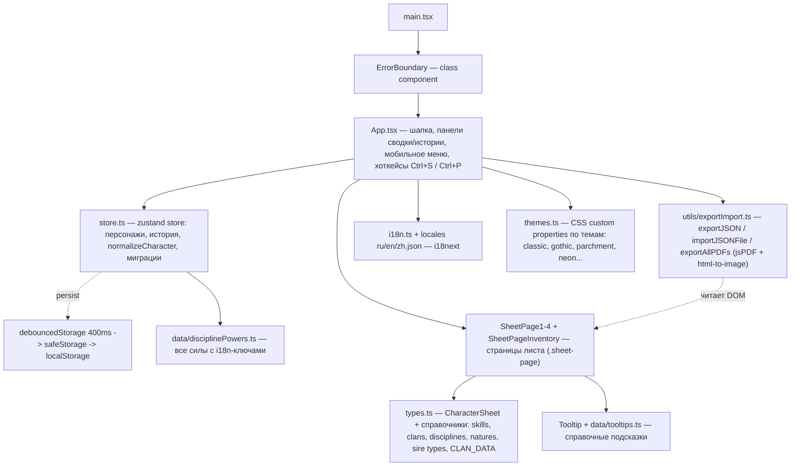

# План: ревизия кода + очистка + документация для AI-агента

## 1. Что найдено при ревизии

**Проект:** VTM 6E — интерактивный лист персонажа (React 18 + TypeScript + Vite, Tailwind CSS, Zustand с persist в localStorage через debounce, i18next ru/en/zh, PDF-экспорт html-to-image → jsPDF, PWA: sw.js + manifest.json). Деплой на GitHub Pages (`base /vtm6elist/`).

### 1.1 Лишнее (удалить)
| Что | Где | Решение |
|---|---|---|
| Тесты: DotRating.test.tsx, exportImport.test.ts, i18n.test.ts, store.test.ts | `src/__tests__/` | Удалить каталог целиком |
| Тест-сетап (jest-dom + моки vibrate/crypto) | `src/setupTests.ts` | Удалить файл |
| Vitest-конфиг (`test: { environment: 'jsdom', ... }`) и импорт из `'vitest/config'` | `vite.config.ts` | Убрать блок, вернуть `import { defineConfig } from 'vite'` |
| Скрипты `test`, `test:watch` + devDeps: vitest, jsdom, @testing-library/* | `package.json` | Удалить (останутся только build/dev/preview/deploy) |

**Логи:** файлов логов в проекте нет; `.gitignore` уже покрывает npm-debug.log и т.п. Оставшиеся 4 вызова `console.error` — легитимные ошибки (ErrorBoundary, экспорт PDF, SW-регистрация), **не трогаем**.

### 1.2 Старые/мёртвые поля данных
| Что | Где | Решение |
|---|---|---|
| Удаление миграторного артефакта `diary` (`delete (normalized as any).diary`) — поле давно не существует в UI | `src/store.ts:243`, `normalizeCharacter` | Убрать строку |
| Legacy-поле `inventory: InventoryItem[]` + интерфейс `InventoryItem` — нигде не используется в UI, только как источник для миграции при загрузке старых сейвов | `types.ts:53`, `store.ts:206-219` | **Сохранить** 8-строчную конверсию inventory→inventoryText (совместимость с уже сохранёнными файлами), убрать из интерфейса только если пользователь захочет полную чистку — по умолчанию оставляем миграцию, убираем всё остальное мёртвое |
| Поле `items: string` и поле `inventoryText` — оба реально используются в UI (разные секции листа) | SheetPage1 / SheetPageInventory | Оставляем оба |

### 1.3 Баги (исправить в рамках ревизии)
1. **Stale-closure Ctrl+P** — эффект клавиатуры в `App.tsx:143-156` с пустым массивом зависимостей вызывает замыкание `handleExportPdf`, захватившее `pdfClassicMode` из момента монтирования. Кнопка Classic работает, горячая клавиша — нет.
   - Фикс: вынести `pdfClassicMode` в ref (как уже сделано для `isExportingRef`) или добавить зависимости эффекта.
2. **Захардкоженные русские строки** ломают i18n en/zh:
   - `App.tsx getDiffList` — «Витэ», «Воля», «Человечность», «Ускорение» и имена характеристик (строки 55-61);
   - панель истории в App.tsx — «История», «Изменений пока нет», «Очистить историю»;
   - оверлей экспорта PDF — «Экспорт PDF», «Страница X из Y», «Подготовка...», «Ошибка экспорта PDF:» (строки 136, 207);
   - `HumanityTracker.tsx:18` — сравнение `label === "Зверь"` вместо i18n-ключа.
   - Фикс: добавить ключи в ru/en/zh locales и заменить на `t(...)`.
3. **Битый favicon** — `index.html:5` ссылается на несуществующий `./vite.svg`; реальный логотип — `Telegram_logo.svg`.

### 1.4 Наблюдения (не в scope, зафиксировать в AGENTS.md)
- `store.ts` — монолит ~760 строк; автозаполнение (клан→бан/зверь/дисциплины, поколение→модификатор, вид→поколение, сир→дисциплина) живёт внутри `updateMeta`. Разбиение на модули — отдельная задача.
- Слабый тайпинг в `updateDiscipline` / `updateResource` (`field: string, value: any`).

## 2. Архитектура (для AGENTS.md)



## 3. Структура файлов после очистки

```
vtm6e-sheet/
├── AGENTS.md                  ← НОВОЕ: документация для AI-агента
├── index.html                 ← починить favicon → Telegram_logo.svg
├── package.json               ← без test/test:watch и testing devDeps
├── vite.config.ts             ← import от 'vite', без блока test
├── tailwind.config.js / postcss.config.js / tsconfig.json
├── public/                    ← manifest.json, sw.js (PWA)
└── src/
    ├── main.tsx               ← вход: ErrorBoundary + App + SW в PROD
    ├── i18n.ts                ← init i18next, экспорт t()
    ├── store.ts               ← zustand (без diary-артефакта)
    ├── types.ts               ← CharacterSheet без мёртвых полей
    ├── themes.ts              ← THEMES + DEFAULT_THEME_ID
    ├── index.css
    ├── App.tsx                ← i18n-строки, фикс Ctrl+P
    ├── components/            ← 9 компонентов (все используются)
    ├── data/                  ← disciplinePowers.ts, tooltips.ts
    ├── hooks/useIsMobile.ts
    ├── locales/{ru,en,zh}.json ← новые ключи для истории/PDF/diff
    └── utils/                 ← storage, debouncedStorage, exportImport
```

## 4. Команды (для AGENTS.md)
- `npm run dev` — HMR; `npm run build` — tsc --noEmit + vite build; `npm run preview`; `npm run deploy` — gh-pages в dist/ с base `/vtm6elist/`.

## 5. Контент AGENTS.md (скелет)
1. **Overview** — что за приложение, для чего.
2. **Architecture** — Mermaid-диаграмма выше + роли ключевых модулей.
3. **Data model** — CharacterSheet: поля, диапазоны (vitae 0..max, willpower, humanity.path 1..7, beast/natureCounter 0..5), правила нормализации и миграций при загрузке.
4. **Auto-fill rules** — таблица: клан→бан/зверь/ярость/дисциплины; поколение→модификатор; вид→поколение; сир→дисциплина; жизнь-пути→+1 навык (с снятием бонуса старого пути).
5. **i18n** — 3 языков, структура ключей, правило: новые строки только в locales, никогда не хардкодить.
6. **Themes** — CSS variables, как добавить тему.
7. **Export/Import** — формат JSON (один персонаж или массив), PDF-экспорт по `.sheet-page`, режим Classic.
8. **Conventions** — TypeScript strict-ish, компоненты в `src/components` с экспортом констант (`export const X`), store-акции через `useCharacterStore.getState()` для импороверов из JSX.
9. **Commands & deployment**.

## 6. Порядок выполнения (todo)
1. Удалить тесты: каталог, setupTests.ts, vitest-блок в vite.config.ts, скрипты и devDeps в package.json.
2. Починить favicon в index.html.
3. Очистка мёртвого кода: diary (store.ts), инвентаризация полей CharacterSheet; миграция inventory→inventoryText оставляем как есть (совместимость).
4. i18n-фиксы: новые ключи в 3 locales + замена строк в App.tsx и HumanityTracker.tsx.
5. Фикс Ctrl+P через ref pdfClassicModeRef.
6. Создать AGENTS.md по скелету п.5.
7. `npm run build` — green; при необходимости `npx tsc --noEmit`.
